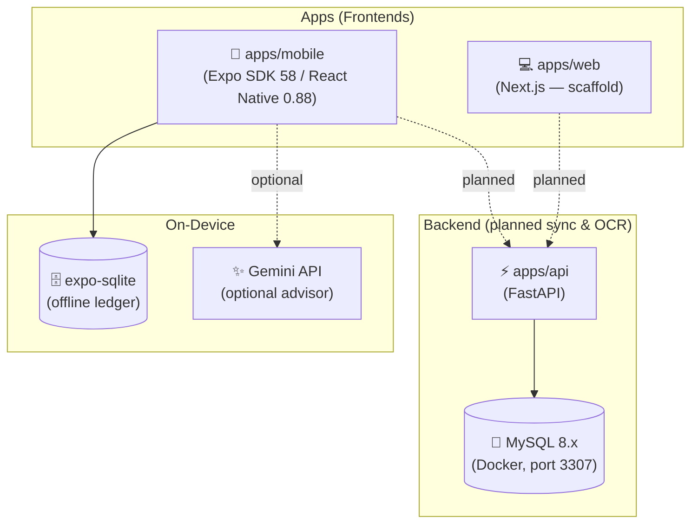

# 💰 Personal Finance Tracker (Monorepo)

A private personal finance tracker built for Philippine banks, e-wallets, and lending apps. It is a **Turborepo monorepo**:

- **Mobile app (React Native / Expo).** This is the main app and it works today. It stores everything on the phone in SQLite and needs no internet.
- **Web app (Next.js), API (FastAPI), and MySQL (Docker).** These are early scaffolding for future sync and receipt OCR.

> [!NOTE]
> **Current status:** the mobile app has all the features. It keeps your data on the device with `expo-sqlite`. `apps/web` and `apps/api` are placeholders. The OCR endpoint returns sample data until a real OCR engine is added.

---

## ✨ Current Features (Mobile App)

The app has five tabs: **Dashboard · Accounts · Advisor · Ledger · Analytics**.

### 🏠 Dashboard
- **Balance hero card** shows your total balance plus recent income and expenses.
- **Active Loans banner** shows your total active debt and the next loan due. Tap it to open the Loans view.
- **Account grid** shows your top institutions with their logos and balances.
- **Quick actions** let you add an **Expense**, **Income**, or **Transfer** in one tap.
- **Recent transactions** lists your latest ledger entries.
- **Dev tools:** a database reset dialog that clears all data back to zero.

### 🏦 Accounts & Pockets
- **Institution presets** come with official names, colors, and logos:
  - **Banks:** BDO, BPI, UnionBank, Metrobank, RCBC, Security Bank, CIMB, Tonik, GoTyme, SeaBank, Maya
  - **E-wallets:** GCash, GrabPay, ShopeePay, Lazada Wallet, TikTok Wallet
  - **Other:** Physical Cash, or a Custom institution
- **Pockets:** each institution can hold several pockets.
  - **Wallet** pockets are for everyday spending.
  - **Interest Savings** pockets have an annual interest rate (% p.a.) and savings details.
- **Account notes:** add and edit free-form notes on any institution.
- **Search and filter** by name, code, or notes. Filter tabs: **All · Banks · E-Wallets · Loans & Debt · Cash**.
- **Institution detail sheet** shows pocket balances, adds pockets, records a quick expense from a pocket, or adds a loan for that institution.

### 💳 Loans & Debt
- **Lending app presets:** BillEase, Tala, Home Credit, Cashalo, plus any bank or e-wallet as the lender.
- **Loan details:** total amount, remaining balance, monthly payment, interest rate, and notes.
- **Due date picker:** a calendar with month navigation and quick presets (*Today*, *+15 Days*, *+30 Days*, *End of Month*).
- **Attachments:** attach a contract or statement, either a photo from the camera or gallery, or a document.
- **Payment reminders:** a local notification is scheduled before each due date (`expo-notifications`).
- **Record payments:** pick the pocket to pay from and the payment date. The app then:
  - deducts the amount from that pocket
  - lowers the loan balance
  - logs a `Loan Payment` expense
  - marks the loan **Paid** once the balance reaches zero
- **Loan summary:** total active debt, active and paid-off counts, and loans due within 7 days.
- If you add a loan for a lender you haven't set up yet, the app creates that institution automatically.

### 🔄 Subscriptions
- **Service presets with SVG logos:** Netflix, Spotify, YouTube Premium, Disney+, iCloud+, Google One, ChatGPT Plus, Canva Pro, Microsoft 365, Amazon Prime, Gym / Fitness, Fiber Internet, plus Custom services.
- **Subscription details:** service name, payment source pocket, billing amount, frequency (`weekly`, `monthly`, `yearly`), start date, next billing date (with calendar date picker), category, and notes.
- **Automatic money deduction & offline catch-up:** when a billing date arrives—or the next time you open the app if your phone was off—the app automatically deducts the amount from the chosen pocket, logs a regular `'expense'` in your ledger, and advances `next_billing_date` to the next cycle.
- **Alerts & notifications:** sends a local reminder 1 day before the billing date and an immediate payment confirmation alert right after auto-deduction.
- **Management & overview:** view active subscriptions, normalized monthly spend, and the next upcoming bill, with one-tap controls to **Edit**, **Pause / Resume**, **Cancel**, or **Delete**.

### 📒 Ledger (Transactions)
- **Three transaction types:**
  - **Expense** and **Income** each have their own preset categories.
  - **Transfer** moves money between pockets and isolates it from income and expense totals.
- Pocket balances update right away and stay consistent through atomic SQLite transactions.
- Filter by type (All / Income / Expense / Transfer).
- Tap a transaction to see its details. Deleting a transaction reverses its effect on the balance.

### 🤖 Advisor ("PocketBot")
- **Chat assistant** that answers questions about your finances in English or Taglish:
  - *"Can I afford a ₱15k phone?"* checks affordability and gives a verdict: **safe**, **tight**, or **unaffordable**
  - *"How much will I have left if I spend 5k?"* gives a projection
  - *"How much do I owe?"* or *"utang"* summarizes your debt and loans
  - *"GCash balance"* or *"total money"* shows balances
- **Understands many amount formats:** `15000`, `15,000`, `₱15,000`, `php 3500`, `15k`, `2.5k`, `2m`.
- **Gemini AI** (`gemini-2.5-flash`) answers using your current balances and loans when an API key is set. Without a key or without internet, it falls back to the built-in **offline rules engine**.
- **Chat history** is saved to SQLite on the device.

### 📊 Analytics & Insights
- **Net savings** for the period, with total inflow and outflow.
- **Spending by category** breakdown.
- **Asset allocation** across Banks, E-Wallets, and Physical Cash.
- **Active debt burden** summary.

### 🎨 UI / UX
- Tab bar extends to the screen edges and stays clear of the Android gesture/nav bar and the iOS Home indicator.
- Styled with Tailwind via **Uniwind**, **PanelUI** components, and **Lucide** icons.
- Built-in date picker and modals use pure React Native, so no extra native modules are needed.

---

## 🏗️ Architecture Overview



---

## 📁 Monorepo Workspace Structure

```text
finance-tracker/
├── apps/
│   ├── mobile/                      # Expo / React Native app (primary)
│   │   ├── app/(tabs)/              # index (Dashboard), accounts, assistant, two (Ledger), analytics
│   │   ├── src/
│   │   │   ├── components/          # accounts, loans, transactions, dashboard, chat, common
│   │   │   ├── constants/           # Institution presets, config (Gemini key)
│   │   │   ├── database/            # SQLite schema, migrations, dev seed
│   │   │   ├── services/            # account, transaction, loan, analytics, chat, gemini, notification
│   │   │   └── utils/               # formatters, calculations, file storage
│   │   ├── tests/                   # Vitest unit tests
│   │   ├── app.json / eas.json      # Expo & EAS Build config
│   │   └── package.json
│   ├── web/                         # Next.js web client (scaffold)
│   └── api/                         # FastAPI service (/health, /ocr/receipt stub)
├── packages/shared/                 # Shared TypeScript types & logic
├── docker/mysql/init.sql            # MySQL schema for the future backend
├── docker-compose.yml               # MySQL 8.x + FastAPI
├── turbo.json
└── package.json
```

---

## 🗄️ On-Device Database (SQLite)

| Table | Description |
| :--- | :--- |
| `institutions` | Banks, e-wallets, cash, and lenders, with color, icon, and notes |
| `account_pockets` | Wallet and savings pockets with starting/current balance and interest rate |
| `transactions` | Income, expense, and transfer records (`to_pocket_id` for transfers) |
| `loans` | Debts with remaining balance, monthly payment, due date, attachment, and status (`active` / `paid` / `defaulted`) |
| `subscriptions` | Recurring subscriptions linked to a payment pocket with frequency (`weekly` / `monthly` / `yearly`), next billing date, and status (`active` / `paused` / `cancelled`) |
| `chat_messages` | Advisor chat history (source: `gemini` or `offline`) |
| `app_settings` | Key/value app settings |

Foreign keys are enforced (`PRAGMA foreign_keys = ON`) and WAL journaling is enabled.

---

## 🚀 Getting Started

### Prerequisites
- [Node.js](https://nodejs.org/) v20+ (npm 11)
- Android device or emulator (for the mobile app)
- *(Optional)* [Docker Desktop](https://www.docker.com/products/docker-desktop/) for the API/MySQL scaffold

### 1. Install dependencies
```bash
npm install
```

### 2. (Optional) Enable the Gemini Advisor
Create `apps/mobile/.env`:
```env
EXPO_PUBLIC_GEMINI_API_KEY=your_key_here
```
> [!WARNING]
> Never commit `.env` or hard-code API keys. GitHub push protection will block the push.

### 3. Run the mobile app
```bash
npm run mobile
# or: cd apps/mobile && npx expo start
```

### 4. Build an installable Android APK (EAS)
```bash
cd apps/mobile
npm run mobile-preview
# = npx eas-cli build -p android --profile preview
```
Install the APK from the EAS build link on your phone.

### 5. (Optional) Backend scaffold
```bash
docker compose up -d
```
- **MySQL:** `localhost:3307`. It maps to internal port 3306, so it won't clash with a local MySQL server.
- **FastAPI:** `http://localhost:8000`, with docs at `http://localhost:8000/docs`.

---

## 🧪 Testing & Code Quality

```bash
# Typecheck all packages
npm run typecheck

# Mobile unit tests (Vitest)
npm test --workspace=@finance-tracker/mobile
```

The tests cover account and pocket balances, transactions, loans (including auto-creating a missing institution and paying a loan down to zero), analytics, the chat engine's intent and amount parsing, the Gemini service, chat storage, notifications, file storage, and formatters.

---

## 🗺️ Roadmap
- [ ] Real receipt OCR (`POST /ocr/receipt`) and camera capture flow
- [ ] Sync from the mobile app to FastAPI and MySQL
- [ ] Web dashboard (Next.js)
- [ ] Budgets, recurring rules, and savings goals
- [ ] Data export and backup

---

## 🔒 Personal Use & Privacy
- All financial data stays **on your device** in SQLite.
- The only data that leaves your phone is the optional Gemini Advisor's summary of your balances and loans. It is sent only when an API key is set.
