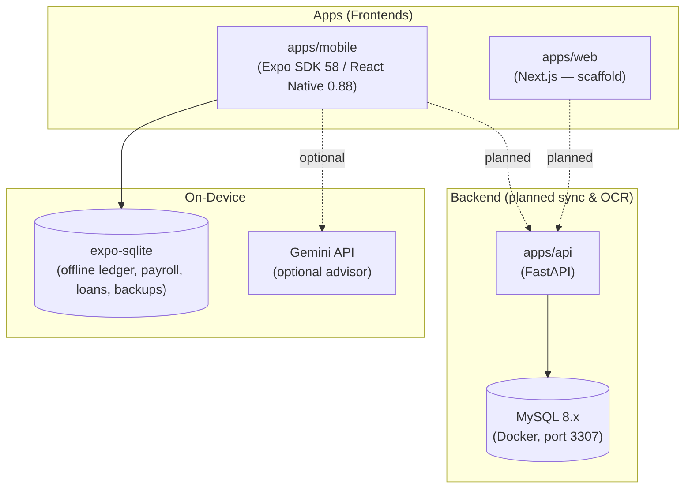

# Personal Finance Tracker (Monorepo)

A private personal finance tracker built for Philippine banks, e-wallets, and lending apps. It is a **Turborepo monorepo**:

- **Mobile app (React Native / Expo).** This is the main app and it works today. It stores everything on the phone in SQLite and needs no internet.
- **Web app (Next.js), API (FastAPI), and MySQL (Docker).** These are early scaffolding for future sync and receipt OCR.

> [!NOTE]
> **Current status:** the mobile app has all the features. It keeps your data on the device with `expo-sqlite`. `apps/web` and `apps/api` are placeholders. The OCR endpoint returns sample data until a real OCR engine is added.

---

## Current Features (Mobile App)

The app combines five bottom tabs (**Dashboard · Accounts · Advisor · Ledger · Analytics**) with a unified top-left **Sidebar Drawer** and an in-app **Notification Center**.

### Dashboard & Navigation

- **Balance hero card** shows your total balance plus recent income and expenses.
- **Status banners** highlight active loans, upcoming subscription renewals, and pending variable-salary paydays waiting for confirmation.
- **Account grid** shows your top institutions with their official brand logos and balances.
- **Quick actions** let you add an **Expense**, **Income**, or **Transfer** in one tap.
- **Recent transactions** lists your latest ledger entries with dual-cue iconography (semantic category avatars paired with micro institution badges).
- **Hybrid Sidebar Drawer:** accessible via the top-left menu button across all tabs for quick navigation to **Accounts**, **Salary & Jobs**, **Loans & Debt**, and **Subscriptions**, as well as **Data Backup (Export / Restore)** and **Reset Database**.
- **Notification Center:** header bell with unread badge counter displaying in-app reminders and auto-deduction confirmations.

### Accounts & Pockets

- **Institution presets** come with official names, colors, and SVG logos:
    - **Banks:** BDO, BPI, UnionBank, Metrobank, RCBC, Security Bank, CIMB, Tonik, GoTyme, SeaBank, Maya
    - **E-wallets:** GCash, GrabPay, ShopeePay, Lazada Wallet, TikTok Wallet
    - **Other:** Physical Cash, or a Custom institution
- **Pockets:** each institution can hold several pockets:
    - **Wallet** pockets are for everyday spending.
    - **Interest Savings** pockets have an annual interest rate (% p.a.) and savings details.
- **Metadata & account notes:** edit pocket details or add free-form notes on any institution.
- **Search and filter** by name, code, or notes. Filter tabs: **All · Banks · E-Wallets · Salary & Jobs · Loans & Debt · Subscriptions · Cash**.
- **Institution detail sheet** shows pocket balances, linked active loans and debt balances for that institution, and quick actions to add pockets, record expenses, or add loans.

### Multi-Job Salary & Payroll

- **Multiple income sources:** track any number of active or archived jobs (`full_time`, `part_time`, `freelance`, `contract`, `other`).
- **Flexible pay schedules:** supports `monthly`, `semi_monthly` (1st and 2nd cutoffs), `biweekly`, `weekly`, and `one_time` project payouts with calendar date selection.
- **Gross-to-net calculation engine:** configure gross salary (`monthly` or `per_paycheck`) and itemized deductions across `tax`, `statutory` (SSS, PhilHealth, Pag-IBIG presets), `workplace`, and `other`. Deductions support fixed peso amounts or percentage rates, plus cutoff-specific targeting (`both`, `first_cutoff`, `second_cutoff`).
- **Variable salary & attendance adjustments (`RecordPaydayModal`):** for attendance-based or variable pay, review and adjust your paycheck before crediting:
    - **Additions:** Overtime Pay, Holiday / Rest Day Pay, and Allowances / Bonuses.
    - **Attendance deductions:** Undertime and Absences / Leave Without Pay (LWOP).
    - **Dynamic tax & net calculation:** percentage-based deductions automatically scale with adjusted taxable gross, or you can toggle **Exact Net Pay** to override the final take-home amount directly.
- **Automated & manual payday processing:** fixed-salary jobs auto-credit your target deposit pocket on payday (or on next app launch if offline), log a `'Salary'` income transaction, and save an itemized payslip. Variable-salary jobs queue a confirmation prompt so you can enter exact attendance figures first.
- **Pay slip receipts (`PaySlipDetailModal`):** view historical payslips with full earnings breakdowns, attendance adjustments, statutory deduction snapshots, and branded deposit pocket badges.

### Loans & Debt

- **Institutional & Peer-to-Peer (P2P) lenders:** choose from lending app presets (BillEase, Tala, Home Credit, Cashalo), any bank or e-wallet (`institution`), or personal lenders (`person`, such as friends or family).
- **Comprehensive contract structure:** track **Principal Borrowed**, **Upfront Processing Fee** (with calculated net cash disbursed), **Total Contract Amount**, **Contract Interest**, monthly installment, and interest rate.
- **Tenor & maturity tracking:** record the loan origination date (`start_date`), tenor duration in months (`term_months`), and next due date, with automatic projected maturity date calculation.
- **Dual progress tracking:** loan cards display both **Monetary Repayment %** and **Tenor Elapsed Months** (`X / Y mos elapsed`).
- **Early payoff interest cashback:** supports loans with early-settlement interest rebates (such as GCash GLoan cashback). Entering a cashback amount on final payoff automatically deposits the rebate into your receiving pocket and records an income ledger entry.
- **Attachments & reminders:** attach contract photos or PDFs, and receive scheduled local notifications before each due date (`expo-notifications`).
- **Record payments:** deducts the installment from your chosen pocket, reduces the loan balance, logs a `Loan Payment` expense, and marks the loan **Paid** once the balance reaches zero.

### Subscriptions

- **Service presets with SVG logos:** Netflix, Spotify, YouTube Premium, Disney+, iCloud+, Google One, ChatGPT Plus, Canva Pro, Microsoft 365, Amazon Prime, Gym / Fitness, Fiber Internet, plus Custom services.
- **Subscription details:** service name, payment source pocket, billing amount, frequency (`weekly`, `monthly`, `yearly`), start date, next billing date (with calendar date picker), category, and notes.
- **Automatic money deduction & offline catch-up:** when a billing date arrives—or the next time you open the app if your phone was off—the app automatically deducts the amount from the chosen pocket, logs a regular `'expense'` in your ledger, and advances `next_billing_date` to the next cycle.
- **Alerts & notifications:** sends a local reminder 1 day before the billing date and an immediate payment confirmation alert right after auto-deduction.
- **Management & overview:** view active subscriptions, normalized monthly spend, and the next upcoming bill, with one-tap controls to **Edit**, **Pause / Resume**, **Cancel**, or **Delete**.

### Ledger (Transactions)

- **Three transaction types:**
    - **Expense** and **Income** each have their own preset categories.
    - **Transfer** moves money between pockets and isolates it from income and expense totals.
- **Atomic balance updates:** pocket balances update right away and stay consistent when creating, editing metadata/categories, or deleting transactions.
- **Dual-cue visual scanning:** each row displays a semantic category icon (`CategoryIcon`) as the primary avatar and a micro institution badge (`PocketBadge`) beside the pocket name.
- **Reversible toast feedback:** actions trigger non-intrusive toast notifications with undo support where applicable.

### Advisor ("PocketBot")

- **Chat assistant** that answers questions about your finances in English or Taglish:
    - _"Can I afford a ₱15k phone?"_ checks affordability and gives a verdict: **safe**, **tight**, or **unaffordable**
    - _"How much will I have left if I spend 5k?"_ gives a projection
    - _"How much do I owe?"_ or _"utang"_ summarizes your debt and loans
    - _"GCash balance"_ or _"total money"_ shows balances
- **Understands many amount formats:** `15000`, `15,000`, `₱15,000`, `php 3500`, `15k`, `2.5k`, `2m`.
- **Gemini AI (`gemini-2.5-flash`):** answers using your live balances, pockets, jobs/salary, subscriptions, and loans when an API key is set. Includes connection probe verification when switching agents, a 20-second timeout with automatic retry, and an animated typing indicator. Without a key or internet connection, it falls back seamlessly to the **offline rules engine**.
- **Timeline chat history:** persisted in SQLite with date group headers and a multiline auto-expanding input field.

### Analytics & Insights

- **Net savings** for the period, with total inflow and outflow.
- **Income visual breakdown (`IncomeVisualBreakdownChart`)** comparing gross pay, statutory/tax deductions, and net take-home pay across active jobs.
- **Spending by category** breakdown and recurring subscription burden.
- **Asset allocation** across Banks, E-Wallets, and Physical Cash, plus active debt summary.

### Data Backup, Restore & Reset

- **Full JSON export & restore (`databaseBackupService`):** export all SQLite tables (institutions, pockets, transactions, loans, subscriptions, jobs, deductions, payslips, chat history, notifications, and settings) to a timestamped `.json` file via the native share sheet, or restore from a backup file with schema validation.
- **Database reset:** clear all local records back to a clean state from the Sidebar Drawer.

### UI / UX Architecture

- **Centralized Icon & Badge System:**
    - `CategoryIcon` maps every expense, income, transfer, and subscription category to semantic Lucide icons and WCAG AA-compliant color tints.
    - `PocketBadge` renders official institution SVG logos (`InstitutionLogo`) with automatic fallback to `PiggyBank` (savings) and `Wallet` (spending) icons across all cards, detail sheets, and searchable dropdown pickers (`SearchableSelectField`).
- **Universal Modal Back-Stack:** opening a child dialog from inside a detail sheet or parent modal (such as editing an item, recording a payment/payday, or adding a pocket) automatically restores the parent sheet when the child dialog closes.
- **Input & layout polish:** live comma-thousands formatting on currency inputs, dynamic keyboard-avoiding modal insets, 12-hour AM/PM time formatting, and safe-area edge-to-edge tab bar styling via **Uniwind** (Tailwind), **PanelUI**, and **Lucide**.

---

## Architecture Overview



---

## Monorepo Workspace Structure

```text
finance-tracker/
├── apps/
│   ├── mobile/                      # Expo / React Native app (primary)
│   │   ├── app/(tabs)/              # index (Dashboard), accounts, assistant, two (Ledger), analytics
│   │   ├── src/
│   │   │   ├── components/          # accounts, chat, common, dashboard, dev, loans, navigation,
│   │   │   │                        # notifications, salary, subscriptions, transactions
│   │   │   ├── constants/           # Institution, subscription, and salary presets; config
│   │   │   ├── context/             # SidebarContext, ToastContext
│   │   │   ├── database/            # SQLite schema, non-destructive migrations, dev seed
│   │   │   ├── services/            # account, analytics, chat, chatStorage, databaseBackup,
│   │   │   │                        # gemini, loan, notification, notificationCenter,
│   │   │   │                        # permission, salary, subscription, transaction
│   │   │   └── utils/               # formatters, calculations, file storage, keyboard utils
│   │   ├── tests/                   # Vitest unit & integration test suites (27 files, 218 tests)
│   │   ├── app.json / eas.json      # Expo & EAS Build config
│   │   └── package.json
│   ├── web/                         # Next.js web client (scaffold)
│   └── api/                         # FastAPI service (/health, /ocr/receipt stub)
├── packages/shared/                 # Shared TypeScript types & logic
├── docker/mysql/init.sql            # MySQL schema for the future backend
├── docker-compose.yml               # MySQL 8.x + FastAPI
├── turbo.json
└── package.json
```

---

## On-Device Database (SQLite)

| Table               | Description                                                                                                                                                                                                                                 |
| :------------------ | :------------------------------------------------------------------------------------------------------------------------------------------------------------------------------------------------------------------------------------------ |
| `institutions`      | Banks, e-wallets, cash, and lenders, with color, icon, and notes                                                                                                                                                                            |
| `account_pockets`   | Wallet and savings pockets with starting/current balance and interest rate                                                                                                                                                                  |
| `transactions`      | Income, expense, and transfer records (`to_pocket_id` for transfers)                                                                                                                                                                        |
| `loans`             | Institutional and personal (P2P) loans with principal, processing fee, total contract amount, remaining balance, monthly payment, start/due dates, term months, interest cashback, attachment, and status (`active` / `paid` / `defaulted`) |
| `subscriptions`     | Recurring subscriptions linked to a payment pocket with frequency (`weekly` / `monthly` / `yearly`), next billing date, and status (`active` / `paused` / `cancelled`)                                                                      |
| `jobs`              | Multi-job employment records with pay schedule (`monthly` / `semi_monthly` / `biweekly` / `weekly` / `one_time`), gross salary, target deposit pocket, variable salary flag, and status (`active` / `archived`)                             |
| `job_deductions`    | Per-job itemized deductions (`tax` / `statutory` / `workplace` / `other`) supporting fixed or percentage rates and cutoff targeting (`both` / `first_cutoff` / `second_cutoff`)                                                             |
| `pay_slips`         | Historical payslip records storing gross pay, basic pay, overtime/holiday/allowance additions, undertime/absence deductions, statutory deduction snapshots, net pay, and linked ledger `transaction_id`                                     |
| `app_notifications` | In-app notification center history with read/unread status                                                                                                                                                                                  |
| `chat_messages`     | Advisor chat history (source: `gemini` or `offline`)                                                                                                                                                                                        |
| `app_settings`      | Key/value app settings                                                                                                                                                                                                                      |

Foreign keys are enforced (`PRAGMA foreign_keys = ON`) and WAL journaling is enabled.

---

## Getting Started

### Prerequisites

- [Node.js](https://nodejs.org/) v20+ (npm 11)
- Android device or emulator (for the mobile app)
- _(Optional)_ [Docker Desktop](https://www.docker.com/products/docker-desktop/) for the API/MySQL scaffold

### 1. Install dependencies

```bash
npm install
```

### 2. (Optional) Enable the Gemini Advisor

Create `apps/mobile/.env`:

```env
EXPO_PUBLIC_GEMINI_API_KEY=your_key_here
```

> [!WARNING]
> Never commit `.env` or hard-code API keys. GitHub push protection will block the push.

### 3. Run the mobile app

```bash
npm run mobile
# or: cd apps/mobile && npx expo start
```

### 4. Build an installable Android APK (EAS)

```bash
npm run mobile:build
# or inside apps/mobile: npm run mobile-preview
# = npx eas-cli build -p android --profile preview
```

Install the APK from the EAS build link on your phone.

### 5. (Optional) Backend scaffold

```bash
docker compose up -d
```

- **MySQL:** `localhost:3307`. It maps to internal port 3306, so it won't clash with a local MySQL server.
- **FastAPI:** `http://localhost:8000`, with docs at `http://localhost:8000/docs`.

---

## Testing & Code Quality

```bash
# Typecheck all packages
npm run typecheck

# Run all unit tests via Turborepo
npm test

# Mobile unit tests directly (Vitest)
npm test --workspace=@finance-tracker/mobile

# Lint and format checks
npm run lint
npm run format:check
```

The test suite (27 test files, 218 tests) covers account and pocket balances, foreign-key validation, transactions, institutional and P2P loans (including tenor calculations and early-payoff interest cashback), multi-job salary calculations, semi-monthly cutoffs, variable attendance payday adjustments, subscriptions and offline auto-deduction, centralized category/institution badge rendering, searchable select fields, sidebar and toast contexts, database JSON backup/restore, notification center, permissions, analytics, the chat engine, Gemini service retries, and formatters.

---

## Roadmap

- [x] Multi-job salary, statutory deductions, and attendance-adjusted payslips
- [x] Peer-to-peer loans, tenor tracking, and early-payoff interest cashback
- [x] Data export and backup (full JSON export & restore)
- [ ] Real receipt OCR (`POST /ocr/receipt`) and camera capture flow
- [ ] Sync from the mobile app to FastAPI and MySQL
- [ ] Web dashboard (Next.js)
- [ ] Budgets and savings goals

---

## Personal Use & Privacy

- All financial data stays **on your device** in SQLite.
- The only data that leaves your phone is the optional Gemini Advisor's summary of your balances and obligations. It is sent only when an API key is set.
