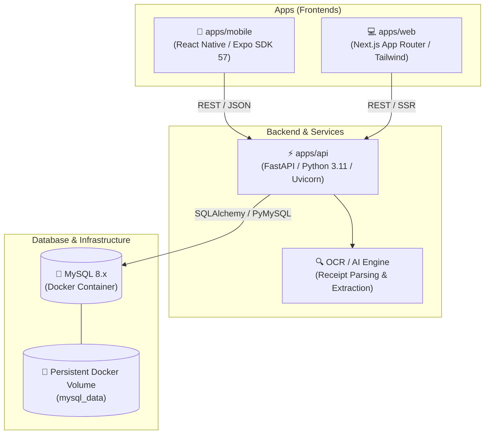

# 💰 Personal Finance Tracker (Monorepo)

A private, full-stack personal finance tracker and ledger system architected as a **Turborepo monorepo** with **React Native** (mobile), **Next.js** (web), **FastAPI** (OCR & AI receipt parser), and **MySQL** orchestrated via **Docker**.

---

## 🏗️ Architecture Overview



### 1. `apps/mobile` (React Native / Expo)
- **Daily Financial Logging**: Quick income, expense, and transfer recording with tactile UI.
- **Camera Receipt Capture**: Capture receipt images directly from mobile and dispatch to FastAPI OCR.
- **Edge-to-Edge Navigation**: Clean 5-tab navigation bar with safe-area clearance for Android gesture/button bars and iOS Home indicator.
- **PanelUI & Tailwind Design**: Themeable (Panel, Moon, Grass) in both Light and Dark modes.

### 2. `apps/web` (Next.js)
- **Desktop Command Center**: Wide-screen dashboard with monthly cashflow trends, ledger analytics, and savings goal projections.
- **Bulk Ledger Management**: Search, multi-criteria filtering, and batch classification of transactions.
- **Receipt Verification Workspace**: Side-by-side view of scanned receipt image and extracted OCR transaction fields before confirming into ledger.

### 3. `apps/api` (FastAPI / Python)
- **Core Financial REST API**: Full CRUD endpoints for accounts, transactions, recurring rules, budgets, and loans.
- **OCR Receipt Parser (`POST /ocr/receipt`)**:
  - Image preprocessing and OCR text extraction.
  - Automatic parsing of vendor name, date, total amount, VAT/tax, and line items.
  - Heuristic/AI classification into Essential **Needs**, Lifestyle **Wants**, or Debt **Obligations**.
- **Database Engine**: SQLAlchemy / SQLModel connection pool managing transactions with MySQL.

### 4. `docker-compose.yml` (Infrastructure)
- Containerizes **MySQL 8.x** and the **FastAPI service** for 1-command startup.
- Keeps your local Windows machine clean with zero manual MySQL server or C++ OCR dependency installation.

---

## 📁 Monorepo Workspace Structure

```text
finance-tracker/
├── apps/
│   ├── mobile/                  # React Native / Expo Mobile Client
│   │   ├── app/                 # Expo Router tabs & modal screens
│   │   ├── src/                 # Mobile context, UI helpers, hooks
│   │   └── package.json
│   │
│   ├── web/                     # Next.js Web Client
│   │   ├── app/                 # Next.js App Router pages
│   │   ├── components/          # Web-tailored dashboard & ledger tables
│   │   └── package.json
│   │
│   └── api/                     # FastAPI Backend & AI Service
│       ├── app/
│       │   ├── main.py          # FastAPI application entrypoint
│       │   ├── config.py        # Environment variables & DB settings
│       │   ├── database.py      # SQLAlchemy engine & session manager
│       │   ├── models/          # SQLAlchemy table models (MySQL)
│       │   ├── schemas/         # Pydantic request/response schemas
│       │   ├── routes/          # Endpoints: /transactions, /accounts, /ocr
│       │   └── services/
│       │       ├── ocr.py       # Receipt image processing & text extraction
│       │       └── ledger.py    # Double-entry balance calculation math
│       ├── requirements.txt     # Python dependencies (FastAPI, uvicorn, PyMySQL, etc.)
│       └── Dockerfile           # FastAPI container definition
│
├── packages/
│   └── shared/                  # Shared TypeScript types, Zod schemas, ledger math
│       ├── src/
│       │   ├── types.ts         # Shared interfaces (Transaction, Account, Goal)
│       │   └── calculations.ts  # Safe-to-spend, savings projection, amortization
│       └── package.json
│
├── docker/
│   └── mysql/
│       └── init.sql             # Initial database schema DDL & seed data
│
├── docker-compose.yml           # MySQL 8.x + FastAPI orchestration
├── turbo.json                   # Turborepo build pipeline
└── package.json                 # Monorepo root workspace configuration
```

---

## 🐬 Database Schema (MySQL)

All tables run in MySQL with strict referential integrity (`InnoDB` engine) and UTF-8 collation (`utf8mb4_unicode_ci`):

| Table | Description |
| :--- | :--- |
| `accounts` | Cash, checking banks, eWallets, credit cards with credit limits and cutoff days |
| `categories` | Income and expense categories with colors and default icons |
| `transactions` | Immutable ledger records with transfer isolation and expense nature |
| `transaction_deductions` | Itemized income deductions (withholding tax, statutory contributions) |
| `recurring_rules` | Scheduled subscriptions and salary rules with automatic cutoff cycle |
| `savings_goals` | Financial targets, accumulated deposits, and target completion dates |
| `loans` | Receivables and payables with interest and remaining balances |
| `wishlist_items` | Planned purchases with live affordability assessment |
| `receipt_scans` | Stored receipt image metadata, raw OCR text, and matched transaction ID |

---

## 🚀 Getting Started

### Prerequisites
- [Docker Desktop](https://www.docker.com/products/docker-desktop/) (running on Windows with WSL2 backend)
- [Node.js](https://nodejs.org/) v20 or later
- [Python](https://www.python.org/) 3.11+ (if running FastAPI outside Docker)

---

### Step 1: Start the Backend & Database (Docker)

Spin up MySQL and the FastAPI service with one command from the project root:

```bash
docker compose up -d
```

- **MySQL**: Running at `localhost:3306` with persistent volume `mysql_data`.
- **FastAPI**: Running at `http://localhost:8000`.
- **Interactive API Docs (Swagger UI)**: Open `http://localhost:8000/docs` in your browser.

To stop the containers:
```bash
docker compose down
```

---

### Step 2: Install Node Monorepo Dependencies

```bash
npm install
```

---

### Step 3: Run the Web App (Next.js)

```bash
npm run dev --filter=web
# or: cd apps/web && npm run dev
```
Open [http://localhost:3000](http://localhost:3000) to view the Web dashboard.

---

### Step 4: Run the Mobile App (React Native)

```bash
npm run start --filter=mobile
# or: cd apps/mobile && npm start
```

- **Local Android Emulator**: Press `a` in the terminal to launch on the emulator.
- **Physical Device**: Build the standalone APK via `npm run build:apk` (or install development client) so custom native modules (`react-native-keyboard-controller`) run properly without crashing.

---

## 🔍 OCR Receipt Scanning Flow

```text
[ Mobile / Web Camera ]
         │
         ▼ (Multipart Image Upload)
[ POST /ocr/receipt ]
         │
         ├── 1. Preprocess image (contrast enhancement, deskew)
         ├── 2. Extract raw text & bounding boxes (OCR Engine)
         ├── 3. Parse total amount, vendor, date, and tax with Regex / NLP
         └── 4. Classify nature: Needs (Groceries/Utilities) vs. Wants (Dining/Entertainment)
         │
         ▼ (JSON Response)
{
  "vendor": "Supermarket Corp",
  "date": "2026-10-22",
  "amount": 1450.50,
  "tax": 155.41,
  "suggested_category": "Groceries",
  "suggested_nature": "needs"
}
```

The user reviews the pre-filled modal on Mobile or Web and taps **Confirm** to commit the immutable transaction into MySQL.

---

## 🧪 Testing & Code Quality

```bash
# Typecheck all TypeScript packages & apps
npm run typecheck

# Run unit tests (ledger math, calculators, Zod schemas)
node --test tests/*.test.ts
```

---

## 🔒 Personal Use & Privacy

This setup is tailored for self-hosted personal usage:
- MySQL data remains strictly local in your Docker container volume.
- Receipt images and financial logs are processed on your local FastAPI microservice without third-party cloud data selling.
- Nightly or weekly database dumps can be taken via `docker exec -i finance-tracker-db mysqldump -u root -p finance_tracker > backup.sql`.
