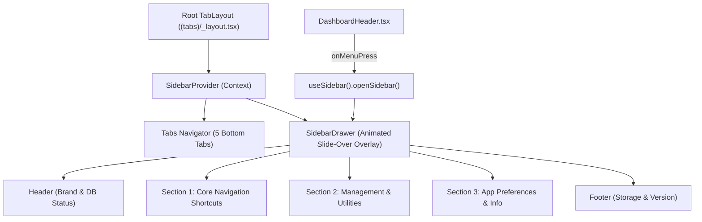

# Hybrid Navigation: Bottom Nav Bar & Slide-Over Sidebar Design Specification

**Created:** 2026-10-31 17:23 (Local Time)  
**Status:** Draft / Review  
**Target Platform:** React Native / Expo (`apps/mobile`)

---

## 1. Overview & Motivation

As the **Finance Tracker** app expands (adding multi-account pocket management, loans, subscriptions, OCR receipts, multi-job salary itemization, digital pay slips, database backups, and PocketBot AI advisory), maintaining a clear, accessible, and uncluttered navigation structure is critical.

A pure hamburger menu hurts core engagement ("out of sight, out of mind"), whereas a bottom navigation bar alone cannot cleanly hold administrative utilities, backups, and secondary directories without cluttering bottom tabs.

### The Solution: Hybrid Navigation Architecture

- **Persistent Bottom Navigation Bar**: Anchors the **5 primary daily workflows** within thumb-reach:
    1. `Dashboard` (`/`)
    2. `Accounts` (`/accounts`)
    3. `Advisor` (`/assistant`)
    4. `Ledger` (`/two`)
    5. `Analytics` (`/analytics`)
- **Slide-Over Sidebar Drawer**: Houses **administrative tools, deep feature hubs, shortcuts, and diagnostics**, triggered by a top-left hamburger menu icon (`☰`) on the Dashboard header and accessible across the app.

---

## 2. Architecture & Component Structure

### Component Breakdown

1. **`SidebarContext.tsx`** (`apps/mobile/src/context/SidebarContext.tsx`):
    - Exposes `isOpen`, `openSidebar()`, `closeSidebar()`, `toggleSidebar()`.
    - Ensures any screen or header can easily control drawer visibility.
2. **`SidebarDrawer.tsx`** (`apps/mobile/src/components/navigation/SidebarDrawer.tsx`):
    - Smooth left-to-right slide animation using `Animated` or `react-native-reanimated`.
    - Semi-transparent backdrop (`rgba(0, 0, 0, 0.45)`) with tap-outside-to-dismiss.
    - Safe area inset handling (top/bottom) for notch and navigation gestures.
3. **`DashboardHeader.tsx`** updates:
    - Integrates top-left hamburger menu button (`Menu` icon from `lucide-react-native`).
    - Maintains date, greeting, OCR scan button, and notification bell alignment.
4. **`DatabaseBackupModal.tsx`** integration:
    - Enables direct backup export/import from the sidebar without needing to hunt for the dashboard database card.

---

## 3. Sidebar Drawer Content & Layout

### Header Block

- **Brand Avatar**: Forest green circle (`#18342B`) with lime accent (`#BBD583`) and `WalletCards` icon.
- **Title**: `Pocket Tracker`
- **Subtitle**: `Personal Financial Suite`
- **Health Indicator**: Green pulsing dot showing `SQLite Database Active`.

### Section 1: Navigation Shortcuts (Direct Jump)

- 📊 **Dashboard** (`/`)
- 💳 **Accounts & Pockets** (`/accounts`)
- 💼 **Income & Salary Directory** (`/accounts` with `income` filter)
- 🤖 **PocketBot AI Advisor** (`/assistant`)
- 📝 **Transactions Ledger** (`/two`)
- 📈 **Analytics & Outflows** (`/analytics`)

### Section 2: Management & Tools

- 💾 **Backup Database** (Exports encrypted `.json` payload via native share)
- 📥 **Restore Database** (Picks local `.json` file and restores tables safely)
- 🔔 **Notification Center** (Opens notifications modal)
- 📋 **Active Loans & Subscriptions** (Direct navigation/filters)

### Section 3: Preferences & System

- ⏰ **12-Hour Time Format** (Status badge: `Active (AM/PM)`)
- ⚡ **AI Engine Default** (`Gemini AI` vs `Offline SQLite`)
- ℹ️ **App Version & Build** (`v1.2.0 • Build 2026.10`)

---

## 4. Animation, Ergonomics & Accessibility

- **Width**: `80%` of screen width, max `340px` on tablets/larger displays.
- **Backdrop**: Smooth fade transition (`opacity: 0 -> 1`).
- **Drawer Slide**: `translateX: -width -> 0` with cubic bezier or ease-out timing (duration: `240ms`).
- **Dismissal**:
    - Tapping the backdrop dismisses the drawer immediately.
    - Tapping any menu item closes the drawer and navigates to the target screen.
    - Hardware back button on Android closes the drawer first if open.
- **Accessibility**:
    - `accessibilityRole="button"` and labels on all drawer items.
    - Appropriate `accessibilityViewIsModal` on the open drawer.

---

## 5. Testing & Verification Plan

1. **Context & State Tests** (`apps/mobile/tests/sidebar_context.test.ts`):
    - Verify `openSidebar`, `closeSidebar`, and `toggleSidebar` state transitions.
2. **Drawer Component Tests**:
    - Verify drawer item rendering, active route highlighting, and navigation callbacks.
3. **Type Safety & Regression**:
    - Monorepo `npm run typecheck` across `@finance-tracker/mobile`, `@finance-tracker/shared`, `@finance-tracker/web`.
    - Full Vitest suite run (`npm run test --workspace=@finance-tracker/mobile`).
