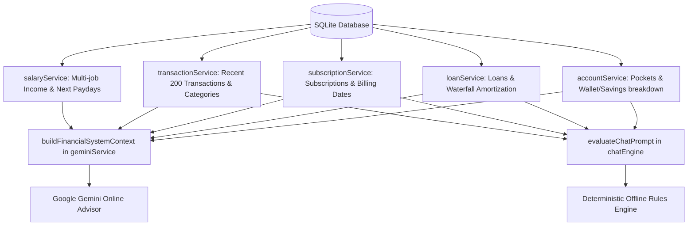

# AI Agent Financial Context Expansion Design

**Created:** 2026-11-01 12:28 (Local Time)

## 1. Overview & Problem Statement

Currently, the in-app AI assistant (`PocketBot` powered by Gemini and the local offline engine) has limited visibility into the user's total financial landscape. It only receives:

1. Pockets and lump-sum balances
2. Active loans and overall loan debt
3. Salary/jobs summary

The AI is currently **blind** to:

- **Subscriptions & Recurring Bills** (`subscriptions` table): The AI has zero knowledge of recurring monthly subscriptions (Netflix, Spotify, Internet, Gym, etc.), causing it to overlook fixed monthly commitments when assessing affordability.
- **Spending History & Outflows** (`transactions` table): The AI cannot answer "How much did I spend this month?", "What's my biggest expense category?", or detect overspending trends.
- **Liquidity vs. Dedicated Savings**: The AI treats emergency savings and daily spendable e-wallet cash as a single pool, risking recommending purchases that deplete emergency funds.
- **Detailed Loan Waterfall Amortization**: The AI doesn't know about advance-settled months or partial residual payments (e.g. Month 4 with ₱854.01 remaining due).
- **Net Monthly Cash Flow**: The AI cannot compute the user's projected monthly savings surplus or burn rate (`Net Income - Fixed Commitments - Discretionary Spend`).

This design expands the context pipeline for both **Gemini AI** (`geminiService.ts`) and the **Offline Engine** (`chatEngine.ts`).

## 2. Architecture & Data Ingestion



### 2.1 Context Dimensions

```typescript
export interface ComprehensiveFinancialContext {
    pockets: (AccountPocket & { institution_name?: string })[];
    loans: LoanRecord[];
    loansSummary: { totalLoanBalance: number; nextDueLoan: LoanRecord | null; activeCount: number };
    incomeSummary?: IncomeSummary;
    subscriptionsSummary?: SubscriptionsAnalytics;
    spendingSummary?: {
        monthlyExpense: number;
        monthlyIncome: number;
        netSavings: number;
        topCategories: CategoryBreakdown[];
        recentTransactions: TransactionRecord[];
    };
    amortizationSchedules?: {
        loanId: string;
        title: string;
        activeInstallmentDue: string;
        residualDue: number;
        settledMonths: number;
        totalMonths: number;
    }[];
}
```

### 2.2 System Prompt Structure (`buildFinancialSystemContext`)

1. **Liquid Capital & Pockets Breakdown**:
    - Spendable Cash (Wallets, E-Wallets, Cash on Hand): `₱X`
    - Dedicated Savings & Emergency Funds: `₱Y`
    - Itemized list with institution names and pocket types.
2. **Income Streams & Expected Cash Inflows**:
    - Monthly Gross and Net Expected Take-Home.
    - Next upcoming payday with company and exact date.
3. **Fixed Monthly Commitments & Obligations**:
    - Total Fixed Monthly Commitments: `₱(LoanPayments + Subscriptions)`
    - Active Loans with Waterfall Installment status (e.g. `GLoan: Month 4 has ₱854.01 due on Jan 12, Months 1-3 settled in advance`).
    - Active Subscriptions with frequencies and next billing dates.
4. **Current Month's Spending & Cash Outflows**:
    - Total outflows recorded this month.
    - Top spending categories with amounts and percentages.
    - Recent 5 transactions (date, category, title, amount).
5. **Projected Monthly Net Cash Flow & Cushion**:
    - Estimated monthly surplus / runway calculation.
    - Safeguards against spending emergency savings funds.

### 2.3 Offline Engine Expansion (`chatEngine.ts`)

- **New Intents**:
    - `subscriptions`: Handles "How much are my subscriptions?", "What bills are due?", "mga subscription".
    - `spending`: Handles "How much did I spend?", "Magkano nagastos ko?", "expenses this month".
- **Enhanced Affordability Rules**:
    - Evaluates both upcoming loans **and** upcoming subscriptions due within 14 days before approving a purchase.
    - Recommends using spendable wallet balance rather than savings pockets.

## 3. Verification & Testing

- Unit tests in `gemini_service.test.ts` verifying that subscriptions, transaction spending summaries, savings separation, and loan waterfall residuals are formatted accurately in the system prompt.
- Unit tests in `chat_engine.test.ts` verifying offline responses for subscription totals, spending queries, and combined commitment affordability checks.
